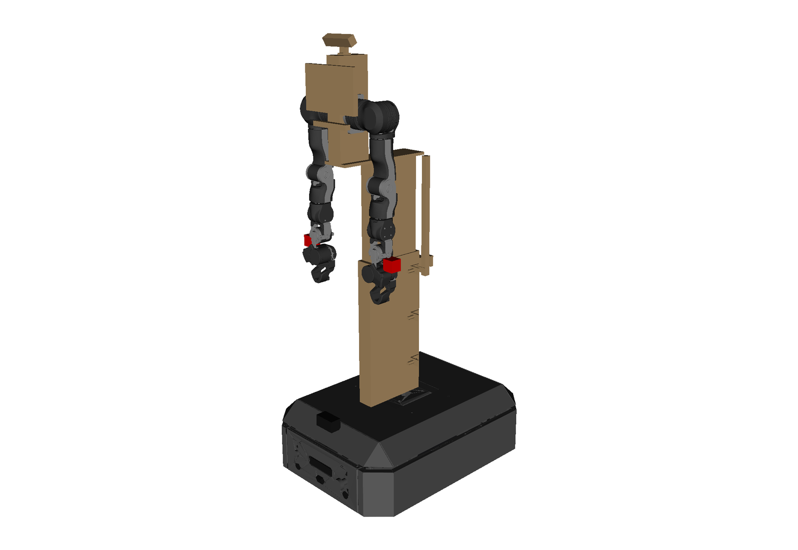
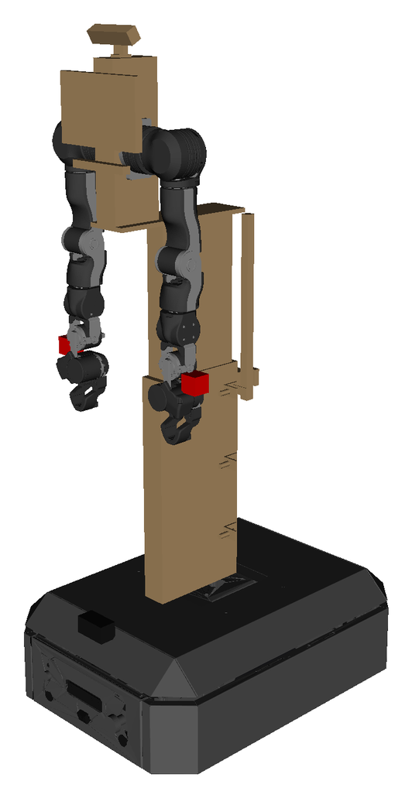

# OpenAMRobot 2.0: open-source mobile base with lift for OpenArm 2.0 dual arms

[](https://codespaces.new/openAMRobot/openamr-upperbody-sw)
[](LICENSE)
[](https://github.com/openAMRobot/openamr-upperbody-sw/actions/workflows/model-tests.yml)

Community discussion: [openamr-upperbody-sw discussion #33](https://github.com/openAMRobot/openamr-upperbody-sw/discussions/33)



*OpenAMRobot 2.0 visualization (assembled, lift raised).*

The combined model puts the mobile base, a 350 mm lift and two OpenArm 2.0 arms in one URDF/Xacro, with MoveIt and Gazebo, ready to fork.
It is built for makers, developers, startups and labs taking OpenArm 2.0 mobile.

From the team behind [openamr-platform-sw](https://github.com/openAMRobot/openamr-platform-sw).

## Status

The combined model is here: mobile base, 350 mm lift and two OpenArm 2.0 arms in one URDF, running with MoveIt and Gazebo (verification: [`docs/verification.md`](docs/verification.md)).
The physical build is underway.
Platform release v2.0.0-rc.1 is targeted for 20 Nov 2026, the dual-arm hardware follows.

Interactive 3D model: https://docs.openamrobot.ai/assets/roadmap/robot.html

## Model and design figures

These are design values from the model, not measurements of a built robot.

| Figure | Design value |
|---|---|
| Shoulder height | 1.00 to 1.35 m |
| Lift travel | 350 mm |
| Maximum assembled height | 1.7 m |

## Prerequisites

- Ubuntu 24.04
- ROS 2 Jazzy

The workspace is `~/openamr_ws`. Its `src/` holds this repository, `openamr-platform-sw` and the two OpenArm repositories under `src/upstream/`, each at the commit pinned in [`upstream_pins.yaml`](ros2/src/openamrobot_upperbody_description/config/upstream_pins.yaml).
This is the layout CI uses ([`.github/workflows/model-tests.yml`](.github/workflows/model-tests.yml)).

```bash
mkdir -p ~/openamr_ws/src/upstream
cd ~/openamr_ws/src
git clone https://github.com/openAMRobot/openamr-upperbody-sw.git
git clone https://github.com/openAMRobot/openamr-platform-sw.git
git -C openamr-platform-sw checkout 131e500fc4e5afc9f648cbd7dbf5b416280761fb
git clone https://github.com/enactic/openarm_description.git upstream/openarm_description
git -C upstream/openarm_description checkout 14ff67b638ff1c738a1b9a6be8aaa5ce5ed2c831
git clone https://github.com/enactic/openarm_ros2.git upstream/openarm_ros2
git -C upstream/openarm_ros2 checkout 4e837e1d0dae692ff67b560b69d8d281d7a8d4ed
```

The commits above are the pins at the time of writing. If they differ, `upstream_pins.yaml` wins.

Install the dependencies of the packages the model needs, as CI does:

```bash
source /opt/ros/jazzy/setup.bash
cd ~/openamr_ws
rosdep install --rosdistro jazzy --ignore-src -y --from-paths $(colcon list --base-paths src --paths-only --packages-up-to openamrobot_upperbody_description openamrobot_upperbody_control openamrobot_upperbody_gazebo openamrobot_upperbody_moveit openamrobot_upperbody_bringup)
```

Build, as in [`docs/verification.md`](docs/verification.md#run-it):

```bash
source /opt/ros/jazzy/setup.bash
cd ~/openamr_ws
colcon build --symlink-install --packages-skip openarm_hardware openarm
source install/setup.bash
```

## Three ways in



*The actual combined URDF in RViz at full lift (L1350). This is what the commands below load.*

Run each command from a shell where the workspace is sourced.

### 1. View the robot

RViz with joint sliders. Use it to check the geometry.

```bash
ros2 launch openamrobot_upperbody_bringup view.launch.py
```

### 2. Try motion planning

MoveIt on mock hardware, with RViz.

```bash
ros2 launch openamrobot_upperbody_bringup moveit.launch.py sim:=mock rviz:=true
```

### 3. Run the simulation

MoveIt in Gazebo, with RViz.

```bash
ros2 launch openamrobot_upperbody_bringup moveit.launch.py sim:=gazebo rviz:=true physics_engine:=gz-physics-bullet-featherstone-plugin
```

Work in progress: the grippers may not close on the default DART engine. Known issues: [Gazebo server teardown](docs/issues/gz-sim_server_teardown_segfault_and_hang.md) and [ros_gz bridge teardown](docs/issues/ros_gz-bridge_teardown_segfault.md).

## Build one or get help

- **Hardware:** [openamr-platform-hw](https://github.com/openAMRobot/openamr-platform-hw)
- **Packages and current prices:** [botshare.ai/openamrobot](https://botshare.ai/openamrobot?utm_source=github&utm_medium=readme#products). First dispatch April 2027.
- **OpenArm 2.0 Mobile Integration Sprint:** your gripper, tool or use case on the combined model, simulated and validated in 3 weeks at a fixed price. [Ask here](https://botshare.ai/openamrobot?utm_source=github&utm_medium=readme#ask).

OpenArm 2.0 components come from the official [OpenArm](https://github.com/enactic/openarm) packages under their own licences. Keep their notices in forks.

## Engineering details

> **Status:** Development. `openamrobot_upperbody_description` provides the option B upper-body description and its tests. The combined base + upper body + arm model (option B's lift model on platform-sw's `base_footprint`, two OpenArm v2.0 arms rooted on its mount frames), the `ros2_control` profiles, the Gazebo, MoveIt and bringup packages and their verification are implemented and verified in simulation and on mock hardware only: see [`docs/verification.md`](docs/verification.md) and the package READMEs. Nothing here is a hardware result.

### What lives here
- **Combined description:** base + lift column + arm profile + arms in one URDF/Xacro, using the official OpenArm arm-mount frames.
- **MoveIt:** arm planning groups and collision configuration on the combined model, with the lift as a planned joint.
- **Bringup:** launch files composing the base, upper body and arm integration from `openamrobot-manipulation`.
- **Configuration metadata:** selected configuration IDs, model/configuration identity and calibration references.
- **Lift control integration:** the lift height is joint state of `lift_joint`; the lift driver and its interlocks are owned by the firmware and safety work packages.

### Current development scope
1. Combined URDF/Xacro with a correct TF tree, collision geometry and documented mounting transforms.
2. Arm simulation through ros2_control, followed by physical integration under the approved work packages and acceptance gates.
3. MoveIt planning and execution on the combined model.
4. Demonstration capture of arm state, base odometry, lift state and versioned configuration identity.

Simulation is an integration stage, not a blanket deferral of physical OpenAMRobot 2.0 work. Model, simulation and hardware acceptance must be recorded separately.

### Upper-body configuration (option B)
Decision of record: P-03 revision 18.9 item 18, 9 October 2026. Heights are from the floor (Z = 0); x forward, y left, z up.

| Item | Value |
|---|---|
| Lift | DOLD Hexalift V4, 350 mm (530 mm retracted, 880 mm extended), 240 mm side fore-aft |
| Base plate | 10 mm aluminium on the 294 mm deck, top face 304 mm; column axis at `bp000` (x +0.060 from base_link, 330 mm behind the chassis front edge) or `bp050` (+0.050 m) |
| Arm profile | MISUMI HFS6-60120, 340 mm, on a 10 mm adapter plate on the column top; 844 to 1184 mm at the retracted lift |
| Arm mount point | `openarm_{side}_base_link` at x = column axis + 0.180 m, y = ±0.031 m, roll/pitch/yaw 0 |
| Shoulder height | 1.000 m at lift 0 (0.304 + 0.530 + 0.166), 1.350 m at lift 0.350 (0.304 + 0.880 + 0.166) |
| Lift joint | `lift_joint`, prismatic, 0 to 0.350 m; calibration stops `L1000`, `L1175`, `L1350` |
| Head camera | ZED Mini on the lift carriage, lens 0.042 m ahead of and 0.223 m above the arm mount point, y = 0 (P-03 rev20.0 item 18, 28 Oct 2026) |
| Maximum assembled height | 1.700 m |

Configuration IDs: `column` (`dold_v4_350`, `tl3_400`), `base_plate` (`bp000`, `bp050`), `head_pitch` (`hp15` to `hp35` in 5 degree steps, baseline `hp30`, P-03 rev20.0 item 17), `base_tilt` (`bt05`, `bt10`, `bt15`). The IDs, baselines and geometry live in [`config/upperbody_configuration.yaml`](ros2/src/openamrobot_upperbody_description/config/upperbody_configuration.yaml), the single input for the xacro arguments, the tests and the configuration hash. `tl3_400` is refused until its column lengths are available from the supplier. The upstream `openarm_body_link0` is not used.

Every configuration ID must stay consistent across URDF/Xacro, MoveIt, TF/camera calibration, the robot configuration hash and dataset metadata. Changing a configuration ID requires the affected calibration and readiness checks.

#### Description package
`ros2/src/openamrobot_upperbody_description`:

| Path | Purpose |
|---|---|
| `urdf/openamrobot_upperbody.xacro` | Macro `openamrobot_upperbody`: column base, `lift_joint`, lift carriage, arm profile, `openarm_{left,right}_base_link`, `head_camera_mount_link`, `head_camera_link`, `head_camera_optical_frame` |
| `urdf/openamrobot_upperbody.urdf.xacro` | Standalone model rooted at `base_footprint` (floor, under the drive-axle midpoint) |
| `config/upperbody_configuration.yaml` | Configuration IDs, baselines and geometry |
| `launch/upperbody_description.launch.py` | `robot_state_publisher` with the configuration IDs as launch arguments |
| `test/` | Every configuration combination (xacro and frame poses) and every buildable combination through TF |

`column_axis_x_bp000` (default 0.060) is the column axis x at `bp000` relative to `base_footprint`; the column axis is 330 mm behind the chassis front edge and 60 mm ahead of the drive axle (P-03 rev19.0 item 19).

Commands (Ubuntu 24.04, ROS 2 Jazzy, `rosdep` initialised; run from a workspace whose `src/` contains this repository's `ros2/src` packages):

```bash
source /opt/ros/jazzy/setup.bash
rosdep install -y --rosdistro jazzy --ignore-src --from-paths src
colcon build --packages-select openamrobot_upperbody_description
source install/setup.bash
colcon test --packages-select openamrobot_upperbody_description
colcon test-result --verbose --test-result-base build/openamrobot_upperbody_description
ros2 launch openamrobot_upperbody_description upperbody_description.launch.py base_plate:=bp050 head_pitch:=hp25
```

### Depends on
- `openamr-platform-sw`: mobile-base model (`base_footprint`, `base_link`) and software.
- `openamrobot-manipulation`: arm integration and manipulation server.
- `openamr-upperbody-hw`: lift, base plate, arm profile geometry, mounting interfaces and as-built measurements.
- `openamr-upperbody-fw`: lift and other upper-body firmware integration, under separately agreed scope.

Package descriptions and model semantics are tracked in [issue #7](https://github.com/openAMRobot/openamr-upperbody-sw/issues/7) and [issue #10](https://github.com/openAMRobot/openamr-upperbody-sw/issues/10).

Part of the OpenAMRobot ecosystem: https://github.com/openAMRobot

## Ownership, licensing, and contributions

OpenAMRobot is a project initiated, operated, and controlled by **Botshare LTD** (Cyprus Company ID HE479056). Botshare LTD owns the transferable economic rights in original OpenAMRobot material created by or validly assigned to it. Third-party material remains subject to its respective ownership, licences, and notices.

Original OpenAMRobot software and firmware are licensed under MIT, documentation under CC BY 4.0, and hardware design source under CERN-OHL-P-2.0, as mapped in [`LICENSING.md`](LICENSING.md). Public distribution grants the permissions stated in the applicable licence; it does not transfer ownership of underlying copyright, trademarks, patents, or other intellectual property.

Accepted external contributions require DCO sign-off and an applicable Individual or Corporate Contributor Agreement. See the organization [IP Policy](https://github.com/openAMRobot/.github/blob/main/IP_POLICY.md), [Contribution Guide](https://github.com/openAMRobot/.github/blob/main/CONTRIBUTING.md), and [Contributor Agreement Process](https://github.com/openAMRobot/.github/blob/main/CLA.md).
