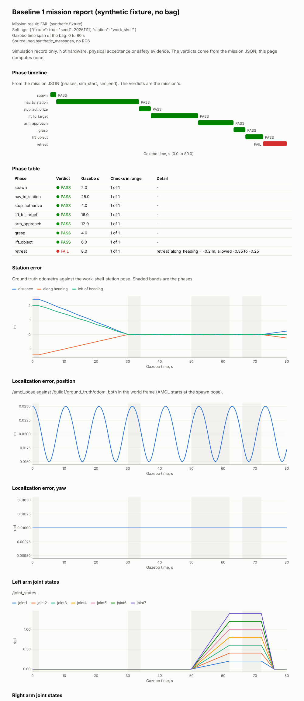

# Digital Twin Control Room

The control room shows a running OpenAMRobot 2.0 simulation (Build 1 scene, Baseline 1 mission, or any launch that
uses the same topic names) and writes an offline HTML report of a recorded run. It lives in
`ros2/src/openamrobot_control_room`.

**It is read only.** It holds no command authority and never goes around the command arbiter of the stack: it
publishes nothing outside `/control_room/`, sends no action goal, calls no service and writes no parameter. Everything
it shows is simulation data: never hardware, physical acceptance or safety evidence.

One demonstration, three views of the same run: **live** next to the running mission (`control_room.launch.py`),
**REPLAY** of that run's recording on its own simulation time (`replay.launch.py`), and the **offline report** of the
same recording (`mission_report.py`). All three read the same topics and the same mission JSON; none adds a component
to the stack. What each part of the run is (Gazebo physics, emulator, host stand-in, unmodified driver, virtual CAN,
Proposed topic) is shown in the status field `provenance`, the report's components table and
[can_signal_paths.md](can_signal_paths.md).

## Control room and operator UI

The control room is the engineering monitor. The operator interface is the existing OpenAMRobot UI
(openamrobot-ui), which connects to the same simulation through its own restricted rosbridge
(`twin.launch.py` of `openamr_ui_bringup`, openamrobot-ui#62). Both can run on one twin at the same time.
Neither replaces the other, and no third frontend is planned.

| | Control room (this package) | Operator UI on the twin (openamrobot-ui) |
| --- | --- | --- |
| Purpose | engineering view: CAN signal paths, mission phases, replay, offline report | operator view as on the robot: map, pose, readiness, task, goals, Stop (software) and Resume |
| Commands | none; publishes only under `/control_room/` | `/goal_pose`, the stop lock services and the cancel services, through the command arbiter of openamr-platform-sw#90; never `/cmd_vel`; manual drive disabled on the twin |
| Bridge | Foxglove bridge, read only; in CI a rosbridge on 9091 with no write, service or action | rosbridge on 9090 with an explicit read and write allowlist, bound to 127.0.0.1 |
| Mission phase | `/baseline1/mission_status` (Proposed) | the same topic, labelled Proposed |
| Evidence | simulation only | simulation only |

The operator UI needs #90 on the platform stack for Stop (software), Resume and goals. Without it the UI shows the
stop state as unknown and sends no goal, while the control room works as before.

## What it shows and where it comes from

| Display | Source topics | Where |
|---|---|---|
| Live scene | robot model, TF, map, costmaps, footprint, planning scene; observer camera `/baseline1/observer/image` (spawned by the mission's recorder), head, base depth, wrist and dock cameras | RViz, Lichtblick 3D and Image panels |
| Mission state and phases | `/baseline1/mission_status` (**Proposed**, published by the Baseline 1 mission from this branch on); the grocery mission's `/grocery_demo/phase` and `/grocery_demo/events` (volatile: a phase published before the control room started is not seen); otherwise only activity inferred from the action status topics, labelled as inferred | `/control_room/status` field `mission` (with its `source`) |
| What ran | `/build1/run_info` of the launch (profile, `stm32`, engine, pose source) and the writers of `/cmd_vel`, `/cmd_vel_nav`, `/cmd_vel_smoothed`, `/sil/lift/command`, `/sil/lift/permit` read from the ROS graph | status `provenance`: each component labelled emulator, host stand-in, real ROS driver, virtual CAN or Gazebo physics; a warning when `/cmd_vel` has a writer other than `collision_monitor` |
| Nav2 goal, plans | `/plan` (its last pose is republished as `/control_room/nav_goal`; the status adds ground truth against it), `/local_plan` | RViz, status `nav` |
| Robot pose and localization error | `/amcl_pose` and the `map` to `base_footprint` transform against Gazebo ground truth `/build1/ground_truth/odom` | `/control_room/localization/position_error`, `yaw_error`, `tf_position_error`; RViz shows AMCL, odometry and ground truth arrows |
| Station error | ground truth against the station pose of `config/scene.yaml` (default `work_shelf`) | `/control_room/station_error`, status `station` (distance, along heading, left, yaw) |
| MoveIt trajectories | `/display_planned_path`, `/monitored_planning_scene`, `/move_action` and `/execute_trajectory` status | RViz MoveIt Trajectory and Planning Scene displays |
| Joint states, lift position | `/joint_states` (`lift_joint`), `/sil/gz/joint_states` (Gazebo physics) | `/control_room/lift/position`, status `lift` |
| Camera and LiDAR | `/scan_filtered`, `/scan`, the camera topics above | RViz, Lichtblick |
| Controller states | CTL-017 emulator: `/sil/lift/status` (the host stand-in's decode of TPDO1 and TPDO2), `/sil/lift/emulator_state`, `/sil/lift/permit` (read); ZLAC8015D emulator: `/sil/drive/status` (stand-in), `/sil/drive/emulator_state`; Daly BMS emulator: `/sil/bms/*`; `/sil/fw/status` exists only with Renode firmware (`stm32:=renode*`) and is shown as absent with that reason otherwise | status `lift`, `drive`, `bms`, `firmware` |
| Virtual CAN | receive-only sockets on `vcan_drive`, `vcan_aux`, `vcan_bms`, `vcan_arm_l`, `vcan_arm_r`; payloads decoded by `can_decode.py` (signal paths and layouts: [can_signal_paths.md](can_signal_paths.md)) | `/control_room/can/summary` (frames, rate per wall second and per Gazebo second, CiA 301 classes, top IDs), `/control_room/can/decoded` (latest engineering value of every signal, last raw frame per ID), `/control_room/can/<bus>/rate_hz` |
| Contacts, grasp, object motion | `/build1/contacts/*` (only with `BUILD1_CONTACT_SENSORS=1`), gripper action status, `/build1/ground_truth/finger_joint_states`, `/build1/ground_truth/item/pose` | `/control_room/contacts/max_force`, `/control_room/item/speed`, status `contacts`, `grasp`, `item` |
| Simulation time, real-time factor | `/clock`, `/build1/rtf`, `/build1/rtf_stats`, `/build1/run_info` | status `sim_time`, `rtf`, `run_info`; Lichtblick plot |
| Test results | the mission JSON (`baseline1_mission.json`) | offline report: phase timeline and phase table; live only through the Proposed mission status topic |

## Run it next to a simulation

Build once, from `ros2/` of a workspace that already builds the Build 1 scene:

```bash
source /opt/ros/jazzy/setup.bash
colcon build --symlink-install --packages-up-to openamrobot_control_room openamrobot_build1_scene
source install/setup.bash
```

Terminal 1, the simulation (Baseline 1 configuration: firmware SIL, Nav2, MoveIt):

```bash
ros2 run openamrobot_build1_scene setup_vcan_all.sh
ros2 launch openamrobot_build1_scene build1.launch.py profile:=firmware_sil nav2:=true moveit:=true
```

Terminal 2, the control room (RViz and the monitors):

```bash
ros2 launch openamrobot_control_room control_room.launch.py
```

Terminal 3, the Baseline 1 mission against the running stack:

```bash
export BUILD1_LOG_DIR=$PWD/build1_logs
python3 -c "import sys; from openamrobot_build1_scene import baseline1, rig; r = rig.run('baseline1_mission', baseline1.mission, needs_devices=True, nav2=True, moveit=True); sys.exit(0 if r[0] == 'PASS' else 1)"
```

For the grocery dark store, start its launch in terminal 1 and the control room with `scene:=grocery_scene.yaml`
(its `packing` station is known only to that scene); the status warns when the scene differs from the run's
`/build1/run_info`. Pick the station for the station error with `station:=<name of the scene's stations>`.

Launch arguments: `rviz` (true), `foxglove` (false), `foxglove_port` (8765), `foxglove_address` (127.0.0.1),
`vcan` (true), `monitor` (true), `use_sim_time` (true), `station` (work_shelf), `scene` (scene.yaml).
`status_log` and `can_log` (empty): files that get every status and every CAN summary with its decoded values as
one JSON line, a record of the live view that needs no second ROS participant.

### In a browser (Lichtblick)

```bash
ros2 launch openamrobot_control_room control_room.launch.py rviz:=false foxglove:=true
```

Open Lichtblick (MPL-2.0, a community fork of Foxglove Studio), connect with "Foxglove WebSocket" to
`ws://127.0.0.1:8765` and import the layout `ros2/src/openamrobot_control_room/config/lichtblick_layout.json`.
The layout has a 3D scene, the observer and head cameras, plots of localization error, station error, lift
position, real-time factor, CAN rates, contact force and item speed, the mission status, control room status and
CAN summary, and the log. It has no Teleop, Publish, Call Service or Parameters panel.

The bridge (`config/foxglove_bridge.yaml`) offers only the `connectionGraph` capability: no `clientPublish`,
`services`, `parameters`, `parametersSubscribe` or `assets`, and the allowlists of those paths match nothing. The 3D
panel's publish buttons therefore have nowhere to publish. Without `assets` the browser cannot fetch meshes from
`package://` URLs, so the robot is drawn from its primitives only.

### The Gazebo window

The control room does not start the Gazebo GUI: its world controls (pause, step, reset) and transform tools write to
the simulation. For a picture of the scene it uses camera topics instead.

## Offline mission report

```bash
ros2 run openamrobot_control_room mission_report.py --bag $BUILD1_LOG_DIR/bag \
  --mission $BUILD1_LOG_DIR/baseline1_mission.json --candump "$BUILD1_LOG_DIR/record_candump_*.log" \
  [--control-room-log status.jsonl can.jsonl] [--time-base-json time_base.json] \
  -o $BUILD1_LOG_DIR/control_room_report.html
```

One static HTML file, no external resources: phase timeline and phase table from the mission JSON, station error,
localization error, left and right arm joint states, lift position (joint states and Gazebo physics), item height,
real-time factor, CAN frame rate, the decoded CAN signals (drive wheel targets and actuals in m/s, lift position and
velocity, left arm MIT command and feedback positions, BMS SOC and voltage, and the first raw frame of every bus and
ID with its decode), a Time base section, the components of the run from its
`/build1/run_info`, the mission status messages, and contact force (when contact sensors were recorded), on the
Gazebo time base with the phases as shaded bands. The station pose comes from `config/scene.yaml` of
`openamrobot_build1_scene` (`--station X Y YAW` or `--scene PATH` to override). The verdicts are the mission's; the
page computes none.

### One time base

The bag (recorded with `--use-sim-time`), the mission JSON (`sim_start`, `sim_end`) and REPLAY are on Gazebo time.
candump stamps frames with host wall time; `timebase.py` maps it to Gazebo time with pairs the run recorded:

- the control room's own status lines (`status_log`, `can_log`): `host_time` next to `sim_time` (the last `/clock`,
  1000 Hz of Gazebo time), late by the executor's queue only. Used when there are at least 20.
- otherwise CTL-017 TPDO1 counters: the frame with counter c on `vcan_aux` and the first `/sil/lift/status` with
  counter c (its `sim_clock.now`). That status is published on a 0.05 s timer, so these pairs are 0 to 50 ms late.

The map is linear between pairs and undefined outside them (frames there are not plotted on Gazebo time). Matching
stops at the first gap in the candump or the bag (after a gap a counter is ambiguous by 25.6 s), and the map is used
only with 20 pairs, 90 % of the candump covered and a leave-one-out p95 under 50 ms; otherwise the CAN plots stay on
host time and say so. The Time base section lists the measured skews: leave-one-out residuals of each pair set, the
TPDO1 map against the control room pairs, and `/baseline1/mission_status` (Proposed) receive times against the
mission JSON phase begins. `control-room-e2e.yml` prints them (`time base: ...`).

`--synthetic DIR` writes a small synthetic bag and mission JSON first and reports them; `--synthetic-plain` renders
the same fixture without ROS. The CI job `control-room-tests.yml` writes the synthetic report on every run and, when
dispatched with a Baseline 1 acceptance run id, the report of that run's recorded bag; both are in the job's artifact.



The picture is the synthetic fixture: invented numbers, not a robot run.

## REPLAY of a recorded run

```bash
ros2 launch openamrobot_control_room replay.launch.py bag:=$BUILD1_LOG_DIR/bag \
  mission:=$BUILD1_LOG_DIR/baseline1_mission.json [rate:=1.0] [start:=SIM_S] [end:=SIM_S]
```

`control_room_replay.py` plays one or more bags (comma separated, merged in time order) on their recorded simulation
time and publishes every recorded non-command topic on `/control_room/replay/<topic>`, the recorded clock on
`/control_room/replay/clock`, and on `/control_room/replay/status` the mode `REPLAY`, the recorded simulation time
and the mission phase and verdict at that time from the mission JSON; `/control_room/replay/label` puts a REPLAY text
with the phase above the recorded base pose. RViz2 runs with `rviz/control_room_replay.rviz` and `/tf`, `/tf_static`
and `/clock` remapped to `/control_room/replay/`, so it draws the recording and never the live graph, even next to a
running simulation. Command topics of the recording (`/cmd_vel*`, controller commands, the lift command and permit,
action topics) are never replayed and are listed in the status. Lichtblick can open the bag file directly with
`config/lichtblick_layout.json`; that view is a file, not live data.

## How read only is enforced and tested

- Every publisher goes through `readonly.guard_publisher_topic`, which refuses any topic outside `/control_room/`.
  The nodes are created without parameter services and create no service or action client.
- `test_monitor_graph.py` reads both monitor nodes from a second node on a live ROS graph: publishers only under
  `/control_room/` (plus `/rosout`, `/parameter_events`), no service client, no action client or server, no
  parameter service. The monitor does not subscribe to any `_action/feedback` topic, because the ROS graph counts
  such a subscriber as an action client.
- `test_foxglove_readonly.py` starts the bridge with the control room configuration and connects a WebSocket client:
  no write capability is offered, a client advertise and messages on `/cmd_vel` create no ROS publisher and deliver
  nothing, a parameter write leaves the probe node's parameter unchanged, an asset request returns no asset.
- `test_vcan_listen.py` sends frames on a test vcan interface and counts every frame on it with a second socket: the
  count equals what was sent, so the monitor transmitted nothing. `ReceiveOnlyBus` has no send method.
- `test_static.py` checks the RViz configuration (view, select, focus and measure tools only; no 2D Goal Pose,
  2D Pose Estimate, Publish Point, Interact or MotionPlanning), the layout and the bridge configuration, that the
  launch file starts only the four monitoring components, and that no source calls a client, goal or parameter API.
- The CI job also starts the launch file and fails if any node it started publishes outside `/control_room/` or has
  a service or action client, and compares the installed package with its source tree (`tools/check_installed.py`).
- Installed package: with the package's source tree moved away, the job checks that the prefix and the Python module
  are in the install space, the four entry points, the launch, config and rviz files under `share/`, that both launch
  files resolve, and runs `mission_report.py` from `lib/`. Then `tools/session_cycles.py` starts and stops the control
  room and its REPLAY three times (SIGINT, SIGTERM, SIGINT): a cycle fails on a component that never published its
  status, a process left behind (every process started carries a marker in its environment), a new ROS 2 daemon or
  a vcan interface left. A negative control (a launch with no monitor) must fail.
- Unknown is not zero: without a contact sensor topic the status has `max_force_n: null` and
  `/control_room/contacts/max_force` is not published; one item pose gives no speed (`test_state.py`,
  `test_monitor_graph.py`, `test_report.py`).
- `tools/check_recording.py` fails the end-to-end job when the control room's bag holds fewer than 10
  `/control_room/status` messages or no CAN topic (run 44445938978 recorded none and passed before).
- `test_topic_audit.py` checks every topic the monitor reads against the topic lists of two recorded runs
  (`test/fixtures/runs`); a topic no run has must be labelled absent with its reason. `test_can_decode.py` decodes
  frames recorded in those runs and checks them against the same runs' status topics and the driver's gains.
- `test_replay.py` plays a bag with a recorded `/cmd_vel` and checks that only `/control_room/replay/` topics come out
  and that `/cmd_vel` is not replayed.

## Proposed

- `/baseline1/mission_status` (std_msgs/String JSON, latched), published by the Baseline 1 mission from its phase
  tracker (`baseline1_phases.Tracker(on_status=...)`, `baseline1.status_publisher`): current phase, state and the
  verdict of every phase, at each phase begin and end and once at the end. Implemented on this branch as Proposed;
  not accepted. Contract change request: openamr-upperbody-sw issue 82. The grocery mission keeps its own
  `/grocery_demo/phase`.

## Limitations

- The live Baseline 1 phase comes from the Proposed topic; a launch without it shows only inferred activity. The
  grocery phase topic is volatile: a control room started late misses the phases before it.
- AMCL against ground truth assumes the map frame equals the Gazebo world frame, as in Baseline 1 (AMCL starts at the
  spawn pose at the world origin). A launch with another map origin shows an offset.
- Contact forces exist only when the scene runs with `BUILD1_CONTACT_SENSORS=1`; the Baseline 1 bag does not record
  them.
- The CAN decode follows the emulators' and the host stand-in's frame layouts (can_signal_paths.md). They are not
  confirmed device protocols: the CTL-017 dictionary is a proposal, the Daly protocol is unconfirmed.
- The CAN plots of the report are on Gazebo time only when the time base passes its checks; a run without the
  control room log and with a gap in the candump stays on host time.
- The replay has no map (the recorders do not record `/map`) and no MoveIt displays.
- Discovery: with `ROS_AUTOMATIC_DISCOVERY_RANGE=LOCALHOST` (the Build 1 tests' isolation) and Fast DDS, a
  participant announces itself only to participant indices 0 to 31 (`maxInitialPeersRange` 32 in rmw_fastrtps);
  two late participants at index 32 or above never match (docs/integration/dds_benchmark.md, #89, measured in run
  44316085344). The control room and its recorder join the mission's 40 or so processes 20 s and 40 s late: in run
  44445938978 the recorder matched `/baseline1/mission_status` (the test process, index near 0) and none of the
  monitor's topics; alone (run 44458551182) the same commands recorded all 16. `control-room-e2e.yml` runs CycloneDDS
  with `MaxAutoParticipantIndex` 120, as `baseline1-acceptance.yml`: run 44476577635 recorded 16 `/control_room/`
  topics (1339 status messages). `status_log` and `can_log` record the live view without discovery.
- Lichtblick draws the robot without meshes (no `assets` capability).
- The foxglove_bridge node keeps its own ROS parameter services (a ROS 2 node default). They are reachable from the
  ROS graph, not from the browser; the bridge's settings are read at start.
- No Nav2 feedback (distance remaining, recoveries): reading it would make the monitor look like an action client.
- RViz and Lichtblick were not rendered headlessly for this page; the only picture is the report of the synthetic
  fixture.
